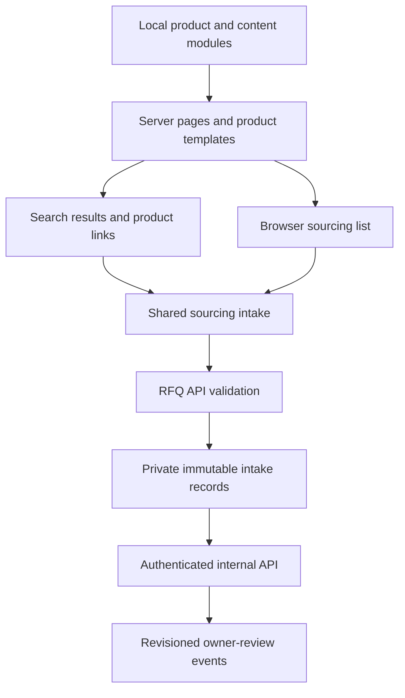

# Architecture overview

The application uses Next.js 15 App Router, React 19 and TypeScript. Public content is assembled from local data modules. Interactive search, forms and sourcing lists sit inside server-rendered pages. RFQ storage and owner-review history use the server-side `@vercel/blob` integration.

## Route map

Route files live under `src/app`. Each public path below has a `page.tsx` entry point, with bracketed segments representing dynamic parameters.

| Paths | Responsibility |
| --- | --- |
| `/` | Search-led landing page and sourcing intake handoffs |
| `/products` | Directory and server-ranked `q` search |
| `/products/[segment]` | Product segment |
| `/products/[segment]/[subcategory]` | Category within a segment |
| `/products/[segment]/[subcategory]/[family]` | Family, configurations and sourcing actions |
| `/products/[segment]/[subcategory]/[family]/[product]` | Product sourcing profile or catalog product |
| `/request-quote` | Query-aware shared RFQ form |
| `/equivalent-finder`, `/samples`, `/contact` | Equivalent, sample and contact intake pages |
| `/equivalents` | Redirect to `/equivalent-finder` |
| `/ready-supply`, `/private-label-oem`, `/private-label` | Availability and private-label review entry points, with separate pages for both private-label paths |
| `/applications`, `/workflows`, `/services`, `/support` | Application, workflow and support routing into product and RFQ paths |
| `/suppliers`, `/supplier-qualification`, `/quality` | Supplier coverage, qualification and documentation review content |
| `/resources`, `/resources/[slug]` | Resource directory and articles |
| `/about`, `/trust-center`, `/privacy`, `/terms` | Platform information, evidence and policies |

`layout.tsx` provides the shared header, footer, skip link, site JSON-LD and `SourcingListProvider`. `manifest.ts`, `robots.ts` and `sitemap.ts` generate their corresponding metadata routes.

### Product route resolution and breadcrumbs

At segment, category and family levels, route handlers resolve taxonomy data first and fall back to catalog data. The product handler resolves `productItems` first and then catalog products. `generateStaticParams` combines the applicable path sets and deduplicates overlapping paths. Unresolved paths use `notFound()`.

Taxonomy pages use `SegmentPageTemplate`, `CategoryPageTemplate`, `FamilyPageTemplate` and `ProductItemPageTemplate`. Catalog fallback rendering is in `components/products/catalog/CatalogPageTemplates.tsx`.

`components/products/Breadcrumbs.tsx` renders the visible hierarchy and its `BreadcrumbList`. Route metadata comes from `lib/siteMetadata.ts`. Directory JSON-LD and site entities use `components/seo/StructuredData.tsx` and `lib/structuredData.ts`.

Product profiles carry an `indexable` flag. Generic profiles receive `noindex, follow`, while the sitemap includes indexable taxonomy product paths. The sitemap builds its product paths from taxonomy helpers and indexable product items. Resource article route generation uses `resourceArticles`, while the sitemap uses `resourceGuides`. Route generation and sitemap membership therefore have separate inputs.

## Data layer

| Module | Ownership and consumers |
| --- | --- |
| `data/productTaxonomy.ts`, `data/productTaxonomy/*` | Primary segment, category and family hierarchy. Segment seeds pass through `builders.ts`. Supplies routes, navigation, search and product profiles. |
| `data/productItems.ts` | Product sourcing profiles derived from taxonomy families with configured product-specific details and indexability. |
| `data/productCatalog.ts`, `data/productCatalog/*` | Parallel catalog model with its own builders, types, seed segments and supplemental menu segments. Supplies catalog fallback routes and filtering. |
| `data/productSearch.ts` | Main `/products` ranking, scientific-unit normalization, match explanations and result limits. Combines taxonomy, indexable product items, verified references and supporting content. |
| `data/catalogReferences.ts` | Evidence-backed reference registry for exact catalog-number matches. The current registry is empty. |
| `data/productNavigation.ts`, `data/navigation.ts` | Derived product hierarchy links and general navigation definitions. The layout passes a compact segment projection to the interactive header. |
| `data/priorityProductContent.ts` | Additional specification, documentation and review content for selected category and family pages. |
| `data/resourceArticles.ts`, `data/resources.ts`, `data/workflows.ts`, `data/supportTypes.ts` | Resource content and workflow/support handoffs. |
| `data/publicTrustProfile.ts`, `data/readySupplyEvidence.ts` | Evidence validation and availability review structures. The line-level confirmation registry is currently empty. |

The route templates intentionally consume both product representations. The main ranked search entry point is `productSearch.ts`. `productTaxonomy.ts` and `productCatalog.ts` also export search helpers for their respective models. Runtime client imports are checked by `client-boundary-regression.mjs` so full catalog and content modules stay server-side.

## RFQ context and browser state

`lib/productRequestHref.ts` contains data-independent URL builders used by sourcing actions. `buildRequestHref` targets `/request-quote`. `buildEquivalentFinderHref` targets `/equivalent-finder`. Both carry the supplied product hierarchy, source page and search query. `SourcingRequestLink.tsx` carries the active search query into RFQ links and, when requested, onward product links.

The `/request-quote` page resolves the following inputs. When repeated values arrive as arrays, it takes the first value.

| Context | Accepted query inputs and priority |
| --- | --- |
| Request mode | `requestType`, then `type`, then `inquiryType`, then a mode inferred from `need`, then `quote` |
| Product hierarchy | `segment`, `subcategory` with `category` fallback, `family`, `product` |
| Product label | `productName` with `product_name` fallback |
| Search and origin | `query` with `q` fallback, `sourcePage` with `sourcePageUrl` fallback, plus `source` |
| Review routing | `workflow`, `need`, `intent`, `supportPath` with `support` fallback, `handoff=manual` |
| Product-list text | `productList` with `list` fallback. `storedInput=1`, `source=sourcing-list` or `source=homepage-hero` activates stored-input handoff behavior. |
| Supplier and SKU | `supplier` with `currentSupplier` fallback, `catalogNumber` with `catalog` fallback |
| Other prefills | `quantity` with `qty` fallback, `timeline`, `requiredDocuments` with `docs` fallback, `productCategory` |

`data/requestTypes.ts` normalizes historical aliases into eight canonical modes. The API has its own request-type normalization. Canonical modes are `quote`, `equivalent`, `sample`, `documentation`, `recurring-supply`, `private-label`, `contact` and `product-list-review`.

The page resolves taxonomy or catalog labels, specifications and document notes into `BioAxisProductContext`, then passes the result through `QuoteRequestForm` to `SourcingIntakeForm`. The form implementation is split between `sourcing-intake/intakeState.ts`, `useSourcingIntake.ts`, field components and context cards. `SimpleRequestForm`, `ContactForm` and compact intake wrappers reuse this implementation.

`SourcingListProvider` persists list items in local storage under `bioaxis:sourcing-list`. List submission saves text and item snapshots in session storage under `bioaxis:sourcing-list-submission` and `bioaxis:sourcing-list-items`, then opens the product-list review intake. The intake restores session snapshots with local-list fallback for items. A successful form response clears the stored handoff and emits an event that clears the shared list. Form fields otherwise live in React state while the page stays open.

`clientRequestId.ts` provides the session request reference. `submitBioAxisRequest.ts` adds source URL, referrer and `utm_*` context before posting JSON. The shared form retains values on API/network failure, refreshes consumed Turnstile verification for retry and offers reference rotation after a conflicting submission.

## RFQ API and persistence

| Endpoint | Behavior |
| --- | --- |
| `GET /api/rfq` | Returns `ready`, `release` and service labels. HTTP 200 requires a reachable queue, configured Turnstile keys and configured internal lookup. Otherwise returns HTTP 503. |
| `POST /api/rfq` | Normalizes and validates intake, applies anti-spam checks and writes an immutable queue record. |
| `POST /api/request-quote` | Compatibility alias that re-exports the RFQ POST handler. |
| `GET /api/rfq/internal` | Bearer-authenticated queue listing or lookup by `requestId`, including workflow state. Successful responses use private, no-store caching. |
| `PATCH /api/rfq/internal?requestId=...` | Bearer-authenticated owner-review event append with operation ID, transition and revision checks. |
| `GET /api/turnstile/config` | Returns public widget configuration. |
| `POST /api/analytics` | Accepts supported funnel events for server logging and optional PostHog capture. |

The RFQ POST handler performs these steps in order.

1. Enforce the 160,000-byte body limit and per-process IP window of 20 requests per minute, then parse bounded JSON.
2. Handle the website honeypot and submissions with a supplied start time less than 700 ms old. These return `mode: honeypot`.
3. Verify the Turnstile token when the secret and public site key are configured, then normalize fields and require a valid email.
4. Use the supplied normalized request ID or generate a reference, then write through `lib/server/rfqQueue.ts`.
5. Return `mode: durable-queue`, the reference ID and replay status on acceptance. A changed payload under an existing reference returns HTTP 409. Queue failure returns HTTP 503 with the reference.

The application limiter uses an in-memory map in each server process. Provider edge enforcement has its own URL-dependent probe. Public readiness checks configuration and queue connectivity. An accepted durable response and authenticated readback provide the storage evidence for a live QA submission.

Queue records are private JSON blobs under `rfq/by-id/<referenceId>.json`, created with a deterministic name and overwrite disabled. The first saved request is immutable. An identical normalized payload replay returns the original record. Workflow events live separately under `rfq/workflow/by-id/<requestId>/`, with new events using sequential revision paths. Workflow reads support legacy events and map legacy `queued` and `reviewing` statuses to `stored` and `in-review`.

The workflow starts at `stored` and permits validated transitions among `in-review`, `needs-info`, `supplier-confirmed`, `responded` and `closed`. Each update supplies an operation ID and owner. State-specific validation, operation replay checks and server-assigned immutable revision slots protect retries and concurrent updates. The operations guide documents the transition table and actual owner-review recording. [RFQ operations](rfq-operations.md)

Funnel events carry the request ID across client submission and server queue outcomes. Server recording limits properties to scalar values and truncates text. Maintain customer-entered details in the RFQ record and keep event payloads limited to operational context. Optional alert-webhook delivery and analytics capture run separately from queue acceptance.

## Configuration ownership and evidence

This table documents configuration names used by the implementation. Keep credentials in the approved server-side configuration channel.

| Names | Role |
| --- | --- |
| `BLOB_READ_WRITE_TOKEN` | Server-only credential for the private intake queue and workflow history |
| `BIOAXIS_INTERNAL_API_KEY` | Server-only bearer credential for internal lookup and owner-review writes |
| `NEXT_PUBLIC_TURNSTILE_SITE_KEY`, `TURNSTILE_SITE_KEY`, `CLOUDFLARE_TURNSTILE_SITE_KEY` | Public widget key and supported aliases, in precedence order |
| `TURNSTILE_SECRET_KEY` | Server-only Turnstile verification credential |
| `POSTHOG_API_KEY`, `POSTHOG_HOST` | Optional server-side event persistence and capture host |
| `BIOAXIS_ALERT_WEBHOOK_URL` | Optional server-only operational alert destination |
| `NEXT_PUBLIC_BIOAXIS_*` | Publishable owner facts, evidence references and review date validated by `publicTrustProfile.ts` |

Trust publication requires both the owner value and its evidence plus a valid non-future date. Enterprise-domain email and measurable response targets have additional checks. The intake example contains placeholders for owner completion. Approved company facts and availability records must enter through evidence review. The owner guide lists the exact public-field mapping. [Public trust owner intake](public-trust-owner-intake.md)

## Build and release identity

`next.config.ts` applies security headers and injects `BIOAXIS_RELEASE_SHA` during the build. A valid `VERCEL_GIT_COMMIT_SHA` takes priority, followed by local `git rev-parse --verify HEAD`, then `unknown`. Accepted SHAs contain 40 or 64 hexadecimal characters and are normalized to lowercase.

`GET /api/rfq` includes the compiled release on both HTTP 200 and HTTP 503. The value identifies the build's selected commit. Working-tree changes require separate verification. The readiness checker accepts `EXPECTED_RELEASE_SHA` to require a full matching SHA. Invalid expected values fail before HTTP requests. Without the expected-release gate, older endpoints with a missing release are reported as `unknown`. Run the offline `test:release` regression to check this behavior.

The regression guide separates offline checks, local HTTP checks, browser acceptance and service-backed operational probes, including each command and its effects. [Regression checks](regression-checks.md)
